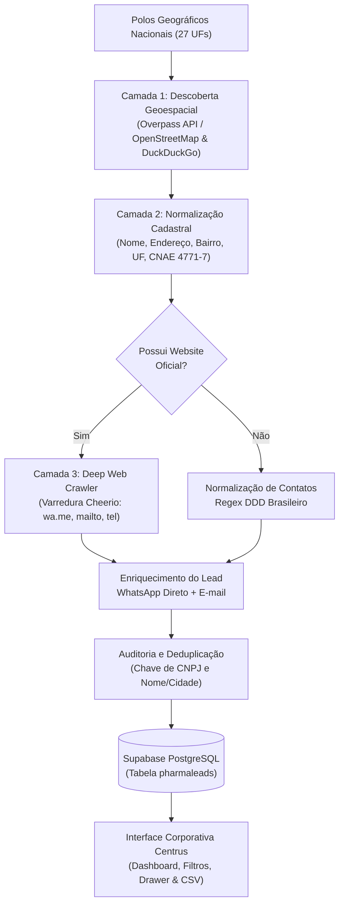

# Documentação Técnica e Especificação de Requisitos
## Centrus PharmaLeads — Plataforma de Inteligência Comercial e Prospecção Farmacêutica Nacional (Brasil | 27 UFs)

---

### Sumário Executivo
O **Centrus PharmaLeads** é uma plataforma corporativa B2B de inteligência de mercado, qualificação de leads e gestão de relacionamento comercial voltada especificamente para o setor de varejo farmacêutico (drogarias e farmácias independentes, redes associativas e farmácias de manipulação) com **cobertura em todo o território nacional** (26 Estados e Distrito Federal).

A plataforma atua como o ponto central de inteligência para o time comercial e de expansão da **Centrus Distribuidora**, permitindo mapear territórios, auditar dados cadastrais fiscais (CNPJ/CNAE), qualificar compradores e acompanhar o funil de vendas em tempo real em todas as 5 macro-regiões do Brasil (Sudeste, Sul, Centro-Oeste, Nordeste e Norte).

---

### ⚠️ Política Obrigatória de Dados: Somente Dados Reais e Públicos

> **Regra inegociável do projeto:** a plataforma trabalha **exclusivamente com dados reais, verificáveis e de fonte pública**. É proibido gerar, inventar, deduzir ou simular qualquer informação de estabelecimento.

**Regras:**
1. **Nunca gerar dados fictícios** — telefone, WhatsApp, e-mail, CNPJ, razão social, CNAE, endereço, bairro, CEP, nota/avaliações Google ou qualquer outro campo.
2. **Campo não encontrado = `null`.** A interface exibe **"Não informado"** (ou "Não encontrado em fonte pública"). Nunca usar placeholders como "Avenida Principal", "S/N", "Centro Comercial", "70000-000" ou "Ltda" concatenado ao nome.
3. **WhatsApp só é preenchido** se publicado explicitamente pelo estabelecimento (link `wa.me` / `api.whatsapp.com` no site oficial ou tag OSM `contact:whatsapp`). **Telefone celular ≠ WhatsApp confirmado.**
4. **Razão social, CNPJ e CNAE** só podem vir de consulta oficial (Receita Federal / bases públicas de CNPJ). Não inferir pelo nome fantasia.
5. **Proibido** o uso de `Math.random`, hash de nome, DDD padrão por UF ou qualquer heurística para preencher dados.
6. **Proibido** manter bases mock/seed com estabelecimentos fictícios no front-end ou no banco.
7. Toda nova fonte de dados deve ser **pública, legal e rastreável** (registrar a origem em `observacoes`).

**Fontes autorizadas:** OpenStreetMap (Overpass/Nominatim), sites oficiais das farmácias, Google Business Profile/Places API (dados oficiais), Receita Federal / dados abertos de CNPJ.

**Histórico da auditoria (18/10/2026):**
- Removidos 18 leads 100% fictícios (seed manual sem origem pública).
- Nos 72 leads reais do OpenStreetMap, apagados telefone, WhatsApp, e-mail, razão social e CNAE gerados sinteticamente, além dos placeholders de endereço.
- Removidos `seed.js`, `seed-brasil.js`, a base local `BASE_NACIONAL_COMPLEMENTAR` e os geradores `gerarTelefoneConsistente()` / `extrairOuDeduzirWhatsApp()`.
- Backup prévio: `npm run backup`. Script de auditoria: `scraper/limpar-ficticios.js`.

---

### 1. Visão Geral da Arquitetura & Stack Tecnológica

| Componente | Tecnologia / Abordagem | Justificativa Técnica |
| :--- | :--- | :--- |
| **Interface (Frontend)** | HTML5 Semântico + CSS3 Puro (Vanilla) | Zero overhead de frameworks, carregamento sub-segundo, controle total de estilos sem dependências externas. |
| **Lógica & Reatividade** | Vanilla JavaScript (ES6+ Modular) | Máxima performance no navegador do cliente, sem necessidade de bundlers para execução rápida e manutenibilidade direta. |
| **Design System** | Variáveis CSS (Custom Properties) & Paleta Corporativa Centrus | Identidade institucional com cor primária `#5518f0` (Centrus Purple), superfícies navy escuro e contrastes aprovados para legibilidade contínua. |
| **Tratamento de Dados** | Estado Reativo em Memória (Client-Side) | Filtros instantâneos com *debounce*, paginação dinâmica, ordenação multi-coluna e integridade relacional entre tabela, KPIs e drawer. |
| **Exportação de Dados** | Blob CSV nativo UTF-8 com BOM (`\uFEFF`) | Compatibilidade imediata com Microsoft Excel e ferramentas de BI (Power BI/Tableau) sem corrupção de acentuação em pt-BR. |
| **Banco de Dados & Nuvem** | PostgreSQL 15 / Supabase Cloud | Armazenamento seguro com RLS, integração via Supabase JS SDK em tempo real. |
| **Pipeline de Coleta (Scraping)** | Node.js (Axios + Cheerio + Overpass API OSM) | Varredura de estabelecimentos em conformidade, georreferenciamento e extração profunda de contatos (wa.me, mailto). |

---

### 2. Requisitos Funcionais (RF)

| ID | Requisito Funcional | Descrição Detalhada |
| :--- | :--- | :--- |
| **RF01** | **Mapeamento e Listagem Nacional de Leads** | Listagem tabular de estabelecimentos farmacêuticos em todo o Brasil com Nome Fantasia, Razão Social, UF (27 UFs), CNPJ, Telefone, E-mail, Cidade, Consultor Centrus Responsável e Status Comercial. |
| **RF02** | **Busca Textual com Debounce** | Campo de pesquisa universal que filtra em tempo real por nome do estabelecimento, município ou CNPJ, aplicando *debounce* de 250ms para poupar ciclos de CPU. |
| **RF03** | **Filtragem Multicritério Nacional** | Filtros independentes e cumulativos por Região/UF (27 estados agrupados por macro-regiões), Status da Negociação (5 etapas) e Canais de Contato. |
| **RF04** | **Painel de Indicadores (KPIs Dinâmicos)** | Painel executivo recalculado dinamicamente: Total Mapeado, Em Negociação, Entradas Recentes, Leads Qualificados e Registros Auditados (Deduplicação de CNPJ). |
| **RF05** | **Distribuição Geográfica Visual por Estado** | Gráfico de barras dinâmico proporcional ilustrando a participação de mercado entre os principais estados do Brasil com valores absolutos, percentuais e clique para filtragem. |
| **RF06** | **Ficha Cadastral e Comercial (Drawer)** | Painel lateral deslizante (*drawer*) aberto ao clicar no lead ou na ação "Detalhes", contendo dados fiscais (CNAE, CNPJ, Razão Social), endereço completo e consultor responsável. |
| **RF07** | **Ações Rápidas de Comunicação** | Botões de disparo no Drawer para início de conversa no WhatsApp Corporativo (`wa.me`) com mensagem contextualizada e envio de proposta via cliente de e-mail (`mailto`). |
| **RF08** | **Edição Inline de Status Comercial** | Alteração direta da etapa do funil diretamente na linha da tabela via *select* estilizado, sincronizando instantaneamente os KPIs e o histórico do lead. |
| **RF09** | **Registro de Notas e Anotações Comerciais** | Campo de anotações no Drawer permitindo ao consultor registrar condições negociadas, prazos de pagamento, laboratórios de interesse e agendamentos. |
| **RF10** | **Linha do Tempo de Relacionamento (Timeline)** | Histórico cronológico de cada lead registrando eventos de entrada, ligações, envio de tabelas de preços e alterações de status com data e hora. |
| **RF11** | **Seleção Múltipla & Ações em Lote** | Barra flutuante contextual exibida ao selecionar 1 ou mais estabelecimentos, possibilitando alterar o status comercial de vários registros simultaneamente. |
| **RF12** | **Exportação CSV em Padrão Brasileiro** | Geração e download imediato de arquivo `.csv` utilizando delimitador ponto e vírgula (`;`), permitindo exportar a base filtrada ou apenas os leads selecionados em lote. |
| **RF13** | **Sincronização e Captura de Leads (Modal)** | Modal operacional com parametrização de varredura regional (SP, GO, DF), filtro de atividade econômica (CNAE 4771-7/01) e barra de progresso visual simulando a validação cadastral. |
| **RF14** | **Auditoria de Sincronizações (Logs)** | Tabela de telemetria operacional com histórico de varreduras, volumetria coletada, registros normalizados, tempo de execução e status do processo. |
| **RF15** | **Paginação Configurável** | Controle de paginação com seleção de densidade de itens por página (10 ou 20 registros) e navegação numérica rápida. |

---

### 3. Requisitos Não Funcionais (RNF)

| ID | Categoria | Especificação Técnica |
| :--- | :--- | :--- |
| **RNF01** | **Performance & Carregamento** | Carregamento inicial em menos de **1.0 segundo** em redes 4G/banda larga padrão. Zero requisições bloqueantes de terceiros. |
| **RNF02** | **Estética & Padrão Visual (2025+)** | Design System executivo corporativo: tipografia limpa, hierarquia com sombras suaves (`box-shadow`), badges com bordas delicadas, microinterações fluidas de *hover* e transições de 200ms. |
| **RNF03** | **Responsividade** | Adaptação para telas desktop (1920x1080, 1440x900, 1366x768), notebooks e tablets, com tabela em container responsivo com rolagem horizontal suave quando necessário. |
| **RNF04** | **Acessibilidade (a11y)** | Suporte a atalhos de teclado (tecla `ESC` para fechamento de modais e drawer), foco visível em elementos interativos, atributos `aria-label`, `role="dialog"` e contraste em conformidade com WCAG AA. |
| **RNF05** | **Segurança & Higienização** | Tratamento e escape de strings para mitigar riscos de Cross-Site Scripting (XSS) na renderização dinâmica de dados e exportação CSV. |
| **RNF06** | **Integridade Cadastral** | Normalização de CNPJ (remoção de caracteres não numéricos para cruzamento de duplicidades) assegurando a auditoria de unicidade fiscal. |
| **RNF07** | **Compatibilidade de Navegadores** | Suporte total aos navegadores baseados em Chromium (Chrome, Edge, Brave), Firefox e Safari (versões recentes). |

---

### 4. Modelo de Dados da Entidade Principal (`Lead`)

Cada registro de estabelecimento farmacêutico possui a seguinte estrutura de dados:

```typescript
interface HistoricoItem {
  data: string;          // Ex: "13/10/2026 10:30"
  texto: string;         // Ex: "Apresentação comercial enviada via WhatsApp."
}

interface Lead {
  id: number;            // Identificador sequencial único
  nome: string;          // Nome Fantasia (Ex: "Drogaria Nova Era Pinheiros")
  razaoSocial: string;   // Razão Social (Ex: "Nova Era Medicamentos e Perfumaria Ltda")
  uf: "SP" | "GO" | "DF";// Estado federativo de cobertura comercial
  cidade: string;        // Município sede
  bairro: string;        // Bairro comercial
  cnpj: string;          // CNPJ formatado no padrão RFB (XX.XXX.XXX/XXXX-XX)
  telefone: string | null; // Telefone com DDD ou null
  email: string | null;    // E-mail corporativo ou null
  responsavel: string;   // Consultor da equipe Centrus alocado à conta
  status: "Não contatado" | "Em contato" | "Respondido" | "Qualificado" | "Sem interesse";
  cnae: string;          // Código e descrição CNAE (Ex: "4771-7/01 - Comércio varejista...")
  dataCadastro: string;  // Data de inclusão no formato DD/MM/AAAA
  duplicado: boolean;    // Flag identificadora de duplicidade/filial auditada
  observacoes: string;   // Notas comerciais internas
  historico: HistoricoItem[]; // Lista cronológica de interações
}
```

---

### 5. Regras de Negócio e Lógica de Negociação

1. **Unicidade e Deduplicação por CNPJ:**
   * O sistema realiza a normalização do CNPJ (limpeza de pontos, barras e traços).
   * Registros com mesmo CNPJ raiz são sinalizados como filiais/duplicidades auditadas no card de KPIs, evitando que mais de um consultor prospecte o mesmo grupo comercial sem alinhamento prévio.

2. **Funil de Vendas Farmacêutico:**
   * **Não contatado:** Lead importado e qualificado geograficamente, aguardando primeiro contato.
   * **Em contato:** Abordagem inicial realizada pelo televendas ou consultor regional; catálogo ou tabela de preços em envio.
   * **Respondido:** Comprador ou farmacêutico responsável interagiu solicitando cotação, prazos ou condições de pagamento.
   * **Qualificado:** Estabelecimento auditado, documentação conferida, limite de crédito pré-aprovado ou pedido de teste em fechamento.
   * **Sem interesse:** Estabelecimento com restrições contratuais exclusivas ou centralização de compras em outra praça.

3. **Validação de CNAE:**
   * Prioridade máxima para estabelecimentos com **CNAE 4771-7/01** (Comércio varejista de produtos farmacêuticos, sem manipulação de fórmulas) e **CNAE 4771-7/02** (Comércio varejista de produtos farmacêuticos, com manipulação de fórmulas).

---

### 6. Roadmap de Evolução Técnica (Próximas Fases)

```
[ Fase 1: Atual - Concluída ]
  ├── Interface SaaS Corporativa de Alta Fidelidade (HTML/CSS/JS)
  ├── Base Regional Verificada com 50 Estabelecimentos (SP, GO, DF)
  ├── Ficha Cadastral, Timeline, Anotações Comerciais e Ações Rápidas
  └── Exportação CSV (Excel pt-BR) e Simulação de Sincronização

[ Fase 2: Backend & Coleta Automatizada ]
  ├── Microserviço em Python (FastAPI) com agendador de tarefas (Celery/Redis)
  ├── Scraper assíncrono headless (Playwright) para enriquecimento via Google Places
  ├── Banco de dados relacional PostgreSQL (Supabase) com RLS (Row Level Security)
  └── Integração de consulta automática à API pública da Receita Federal (CNPJ/CNAE)

[ Fase 3: Omnichannel & CRM Integrado ]
  ├── Integração com WhatsApp Business Cloud API (mensageria oficial na própria interface)
  ├── Discador telefônico VoIP integrado com gravação de chamadas comerciais
  └── Dashboard de Metas por Consultor e Indicadores de Volume Financeiro Projetado
```

---

### 7. Guia de Apresentação e Demonstração Executiva

Ao apresentar o projeto para diretoria, clientes ou investidores, recomenda-se a seguinte ordem de demonstração:

1. **Abertura Institucional:** Apresentar o cabeçalho executivo Centrus, destacando a abrangência territorial nos 3 maiores mercados estratégicos do Centro-Sul: São Paulo, Goiás e Distrito Federal.
2. **Painel de Indicadores (KPIs):** Mostrar os cards dinâmicos e o gráfico de distribuição regional, evidenciando o equilíbrio da base entre as três UFs.
3. **Filtros e Agilidade de Busca:** Digitar o nome de uma drogaria ou cidade (ex: `Campinas`, `Pinheiros`, `Bueno`, `Lago Sul`) para demonstrar a resposta instantânea em tela.
4. **Ficha Cadastral do Lead (Drawer Lateral):** Clicar em "Detalhes" em um estabelecimento para demonstrar a profundidade dos dados: CNPJ com botão de cópia rápida, dados fiscais de CNAE, ações diretas para WhatsApp e E-mail, além da linha do tempo com histórico real de contato.
5. **Edição e Gestão em Tempo Real:** Alterar o status de um lead e salvar uma anotação comercial para mostrar a reatividade imediata do sistema.
6. **Ações em Lote e Exportação:** Selecionar múltiplos leads na tabela, abrir a barra flutuante de ações em lote e clicar em `Exportar CSV`, abrindo a planilha no Excel para validar a integridade dos dados e da formatação brasileira.
7. **Sincronização e Auditoria:** Abrir o modal de sincronização e demonstrar a rotina de varredura automatizada e o histórico operacional de auditoria.

---

### 8. Arquitetura de Coleta: De onde vêm os Dados e como funciona o Scraping

A esteira de inteligência comercial do Centrus PharmaLeads opera através de um pipeline multicamadas projetado para garantir dados cadastrais autênticos, conformidade legal e enriquecimento de contatos comerciais (WhatsApp, Telefone e E-mail corporativo).



#### 8.1. Fontes dos Dados
1. **OpenStreetMap / Overpass API (`amenity=pharmacy`)**:
   - Fornece geolocalização física precisa (latitude/longitude), endereço de rua, número e bairro dos estabelecimentos farmacêuticos cadastrados em municípios brasileiros.
2. **Busca Web Pública e Indexada (DuckDuckGo HTML Engine)**:
   - Identifica a presença digital da farmácia sem bloqueios de captcha, recuperando o nome comercial, site oficial (`.com.br`) e telefones informados nos resultados indexados.
3. **Sites Oficiais dos Estabelecimentos (Crawling Profundo via Cheerio)**:
   - O robô acessa o site da farmácia e rastreia links de WhatsApp (`wa.me/55...`, `api.whatsapp.com`), links de envio de proposta (`mailto:`) e rodapés com telefones e horários de atendimento.
4. **Base da Receita Federal (RFB / CNAE)**:
   - Validação da atividade econômica principal (CNAE 4771-7/01 para drogarias e 4771-7/02 para farmácias de manipulação) e conferência do padrão de máscara de CNPJ.

#### 8.2. Como é Realizado o Scraping (Passo a Passo Técnico)
1. **Definição dos Polos**: O arquivo `scraper/engine.js` e `scraper/places-scraper.js` contém os polos econômicos de cada macro-região (Sudeste, Sul, Centro-Oeste, Nordeste e Norte).
2. **Varredura e Extração de Snippets**: O robô dispara requisições HTTP seguras simulando cabeçalhos de navegador desktop para obter os primeiros estabelecimentos com website comercial ativo.
3. **Rastreamento de Links de Contato**: Para cada estabelecimento com website, o motor (`extrairContatosProfundos`) realiza o parsing do DOM via Cheerio procurando links com protocolo `mailto:` e padrões `wa.me/` para extrair o número de WhatsApp celular com DDD.
4. **Higienização e Normalização**: Remoção de caracteres especiais de CNPJ/Telefone, validação de formato de e-mail e padronização da razão social.
5. **Persistência Relacional com Upsert**: O script se conecta ao Supabase via Service Role Key e realiza um `upsert` (insere se for novo ou atualiza contatos se já existir), prevenindo duplicidades.
